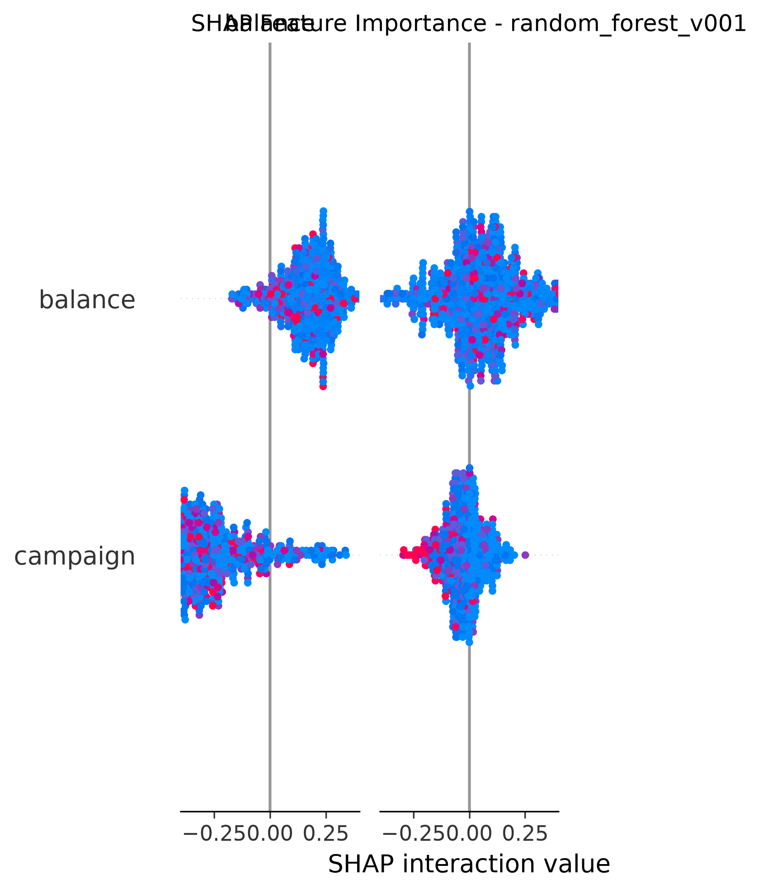
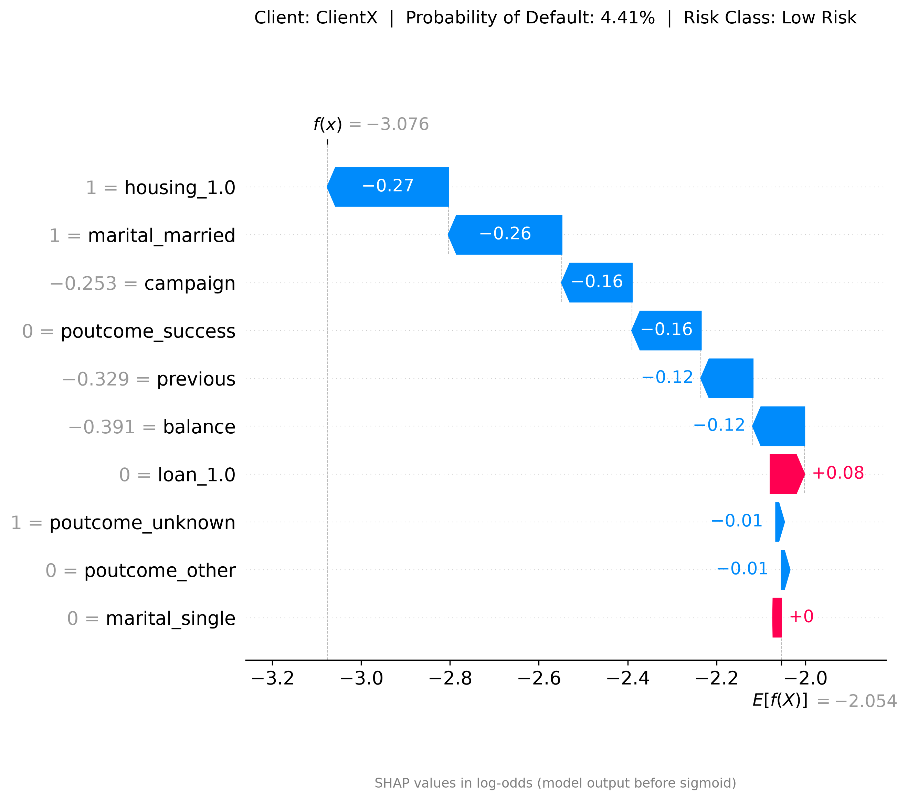

# Credit Scoring Modelling

> Projet de Machine Learning **end-to-end** : de la donnée brute jusqu'à une application web de scoring, avec suivi des expériences (MLflow), interprétabilité (SHAP) et tests automatisés.


---

## Sommaire

- [Objectif](#objectif)
- [Données](#données)
- [Architecture du projet](#architecture-du-projet)
- [Installation](#installation)
- [Utilisation](#utilisation)
  - [1. Entraînement](#1-entraînement)
  - [2. Prédiction sur le jeu de test](#2-prédiction-sur-le-jeu-de-test)
  - [3. Évaluation et rapports](#3-évaluation-et-rapports)
  - [4. Suivi des expériences avec MLflow](#4-suivi-des-expériences-avec-mlflow)
  - [5. Application web (FastAPI)](#5-application-web-fastapi)
- [Configuration](#configuration)
- [Modèles et résultats](#modèles-et-résultats)
- [Interprétabilité](#interprétabilité)
- [Tests](#tests)
- [Commandes Makefile](#commandes-makefile)
- [Feuille de route](#feuille-de-route)
- [Auteur](#auteur)

---

## Objectif

Construire un modèle de **classification binaire** qui estime, pour un client, une probabilité (`predict_proba`) et une classe prédite, puis l'exposer via une interface web qui :

1. recueille les informations du client via un formulaire ;
2. renvoie la **probabilité**, la **classe prédite** et une **classe de risque** ;
3. explique la décision grâce à un **graphique SHAP waterfall** propre au client.

Le projet met l'accent sur les bonnes pratiques MLOps : code modulaire, configuration externalisée en YAML, validation des schémas de données, versionnage des modèles, traçabilité des expériences et tests unitaires / d'intégration.

---

## Données

| Élément | Détail |
|---|---|
| Source | [UCI Bank Marketing Dataset](https://archive.ics.uci.edu/dataset/222/bank+marketing) — Moro et al., 2011 |
| Fichiers | `data/raw/bank.csv` (4 521 lignes, utilisé pour l'entraînement), `data/raw/bank-full.csv` (45 211 lignes) |
| Description | `data/raw/bank-names.txt` |
| Séparateur | `;` |
| Cible | `y` (`yes` / `no`) — classe positive minoritaire (~11,5 %) |

> ℹ️ Dans le jeu de données d'origine, `y` indique si le client a souscrit un dépôt à terme. Le projet utilise ce jeu de données public comme support pour mettre en place une chaîne complète de scoring.

**Variables utilisées par le modèle** (`src/scoring_model/features/selected_features.py`) :

| Type | Variables |
|---|---|
| Numériques | `balance`, `campaign`, `previous` |
| Catégorielles | `marital`, `housing`, `loan`, `poutcome` |

**Feature engineering** (`features/engineering.py`) : `total_contacts = campaign + previous` et `balance_per_contact = balance / total_contacts`.

Le schéma complet (types, bornes, modalités autorisées) est défini dans `configs/data.yaml` et contrôlé avec **Pandera** avant tout traitement.

---

## Architecture du projet

```text
credit-scoring-modelling/
├── configs/                      # Configuration YAML (aucun paramètre en dur)
│   ├── config.yaml               #   métadonnées du projet, graine aléatoire
│   ├── data.yaml                 #   formats de lecture + schéma de validation
│   ├── training.yaml             #   split, preprocessing, rééchantillonnage
│   ├── models.yaml               #   hyperparamètres des modèles
│   └── experiments.yaml          #   paramètres MLflow
│
├── data/
│   ├── raw/                      # Données brutes (CSV)
│   ├── intermediate/             # Train/Test après split, non transformés (.parquet)
│   └── processed/                # Données transformées + prédictions (.parquet)
│
├── notebooks/
│   ├── 01_eda.ipynb              # Analyse exploratoire
│   └── credit_scoring_model.ipynb
│
├── src/
│   ├── main.py                   # Point d'entrée de l'application FastAPI
│   │
│   ├── api/                      # Application web
│   │   ├── middleware/           #   sessions + gestion des erreurs de validation
│   │   ├── modules/              #   schémas Pydantic, chargement modèle, flash messages
│   │   ├── routes/router.py      #   routes  GET /  ·  POST /predict  ·  GET /result
│   │   ├── templates/            #   pages HTML (Jinja2)
│   │   └── static/css/           #   feuilles de style
│   │
│   └── scoring_model/            # Cœur Machine Learning
│       ├── dataset/              #   chargement, validation, métadonnées, split
│       ├── features/             #   feature engineering, preprocessing, processeur entraîné
│       ├── models/
│       │   ├── models_loader.py  #   instanciation / entraînement / sauvegarde
│       │   ├── registry/         #   tous les modèles versionnés (<nom>_<version>.joblib)
│       │   └── latest/           #   modèle servi par l'API
│       ├── eval_artefacts_func/  #   métriques, courbes, SHAP, rapport, MLflow
│       ├── reports/              #   figures, métriques JSON, rapport Markdown
│       ├── runtime/              #   chargement des configs, gestion des chemins
│       ├── scripts/              #   train.py · predict.py · eval.py
│       └── utils/                #   casting, imputation, statistiques descriptives
│
├── tests/
│   ├── unit/                     # Tests unitaires (un fichier par module)
│   ├── integration/              # Tests des pipelines train / predict / eval
│   ├── unit_tests_reports/       # Rapports HTML (pytest-html)
│   └── integration_tests_reports/
│
├── mlartifacts/ · mlflow.db      # Artefacts et base de suivi MLflow
├── pyproject.toml · uv.lock      # Dépendances (uv)
├── requirements.txt              # Dépendances figées (générées depuis pyproject)
├── Makefile                      # Raccourcis des commandes
└── .env.example                  # Variables d'environnement attendues
```

### Pipeline

```text
 bank.csv
    │
    ▼
 [1] Chargement ──► [2] Validation (Pandera) ──► [3] Casting des colonnes
    │
    ▼
 [4] Feature engineering ──► [5] Split train/test stratifié (80/20)
    │                                   │
    ▼                                   └──► data/intermediate/*.parquet
 [6] Imputation des valeurs manquantes
    │
    ▼
 [7] ColumnTransformer (StandardScaler + OneHotEncoder) ──► processor_fitted.joblib
    │
    ▼
 [8] Entraînement ──► models/registry/<modele>_<version>.joblib
    │
    ▼
 Prédiction ──► Évaluation (métriques, courbes, SHAP) ──► MLflow
    │
    ▼
 Application FastAPI (models/latest/)
```

---

## Installation

### Prérequis

- Python **3.11+**
- [uv](https://docs.astral.sh/uv/) (recommandé) ou `pip`
- `make` (optionnel, pour les raccourcis)

### Étapes

```bash
# 1. Cloner le dépôt
git clone https://github.com/Atji00/Atji_projects.git
cd credit-scoring-modelling

# 2. Créer l'environnement et installer les dépendances
uv sync                       # avec uv (installe aussi le groupe dev)
# ou
python -m venv .venv
.venv\Scripts\activate        # Windows  (source .venv/bin/activate sous Linux/macOS)
pip install -r requirements.txt
pip install -e .              # rend les packages `scoring_model` et `api` importables

# 3. Variables d'environnement
cp .env.example .env
```

Renseigner dans `.env` une clé secrète pour signer les cookies de session de l'application web :

```env
SESSION_SECRET_KEY=une-chaine-longue-et-aleatoire
```

> Le `Makefile` utilise `.venv/Scripts/python.exe` (chemin Windows). Sous Linux/macOS, remplacer par `.venv/bin/python`.

---

## Utilisation

### 1. Entraînement

```bash
make train
# équivalent : python src/scoring_model/scripts/train.py
```

Le script demande de manière interactive :

- le **nom du modèle** : `logistic_regression`, `random_forest` ou `xgboost` (doit être `enabled: true` dans `models.yaml`) ;
- la **version** : par exemple `v001`.

Sorties :

- `data/intermediate/unprocessed_{train,test}/` — jeux après split ;
- `data/processed/processed_train/X_train_processed.parquet` ;
- `src/scoring_model/features/processor_fitted.joblib` — préprocesseur entraîné ;
- `src/scoring_model/models/registry/<modele>_<version>.joblib` — modèle entraîné.

### 2. Prédiction sur le jeu de test

```bash
make predict
```

Le modèle utilisé est défini par la constante `MODEL_NAME` dans `src/scoring_model/scripts/predict.py`. Les résultats sont écrits dans `data/processed/processed_test/` (`X_test_processed`, `y_predicted`, `y_probability`).

### 3. Évaluation et rapports

```bash
make evaluate
```

Génère pour le modèle courant :

| Artefact | Emplacement |
|---|---|
| Rapport de classification (JSON) | `reports/metrics/<modele>/` |
| Matrice de confusion, courbes ROC et Précision-Rappel, learning curve | `reports/figures/<modele>/` |
| SHAP summary, SHAP bar, SHAP waterfall | `reports/figures/<modele>/` |
| Rapport Markdown consolidé | [`src/scoring_model/reports/Readme.md`](src/scoring_model/reports/Readme.md) |

### 4. Suivi des expériences avec MLflow

```bash
# Terminal 1 : démarrer le serveur MLflow (http://127.0.0.1:8080)
make mlflow-start
```

Puis lancer l'évaluation avec la journalisation activée :

```python
from scoring_model.scripts.eval import eval_orchestration
eval_orchestration(enable_mlflow=True)
```

Chaque run enregistre les hyperparamètres, les métriques (precision, recall, f1 sur la classe positive, accuracy) et le modèle sérialisé au format `skops`. Le backend est la base SQLite `mlflow.db` et les artefacts sont stockés dans `mlartifacts/`.

### 5. Application web (FastAPI)

```bash
make run_uvicorn
# équivalent : python src/main.py
```

Ouvrir ensuite <http://127.0.0.1:8000>.

| Méthode | Route | Rôle |
|---|---|---|
| `GET` | `/` | Formulaire de saisie des informations client |
| `POST` | `/predict` | Validation (Pydantic), prédiction, redirection |
| `GET` | `/result` | Probabilité, classe prédite, classe de risque et waterfall SHAP |
| `GET` | `/docs` | Documentation OpenAPI générée par FastAPI |

**Champs du formulaire** (`api/modules/pydantic_scheme.py`) :

| Champ | Type | Contrainte |
|---|---|---|
| `name`, `email` | texte (optionnel) | non utilisés par le modèle |
| `balance` | réel | solde du compte |
| `campaign` | entier | ≥ 1 |
| `previous` | entier | ≥ 0 |
| `marital` | liste | `married`, `single`, `divorced` |
| `housing`, `loan` | booléen | prêt immobilier / prêt personnel |
| `poutcome` | liste | `success`, `failure`, `other`, `unknown` |

En cas de saisie invalide, l'utilisateur est redirigé vers le formulaire avec des messages d'erreur lisibles et ses valeurs pré-remplies.

**Classes de risque** affichées selon la probabilité prédite :

| Probabilité | Classe |
|---|---|
| < 5 % | Low Risk |
| 5 % – 15 % | Medium Risk |
| ≥ 15 % | High Risk |

Le modèle servi est `src/scoring_model/models/latest/random_forest_v001.joblib` (défini dans `api/modules/prediction_artefacts.py`). Pour déployer un autre modèle, copier le fichier depuis `registry/` vers `latest/` et mettre à jour ce chemin.

---

## Configuration

Tous les paramètres sont externalisés dans `configs/` et chargés via `scoring_model.runtime.config.ConfigLoader`.

| Fichier | Contenu principal |
|---|---|
| `config.yaml` | Nom, version, description du projet ; `rd_seed: 42` |
| `data.yaml` | Formats d'entrée (CSV `;`, TXT tabulé), taille max, nom de la cible, schéma de validation colonne par colonne |
| `training.yaml` | `test_size: 0.20`, split stratifié ; `StandardScaler` ; `OneHotEncoder(drop="first", handle_unknown="ignore")` ; rééchantillonnage `smotenc` |
| `models.yaml` | Activation et hyperparamètres de chaque modèle |
| `experiments.yaml` | URI de tracking, nom d'expérience, tags, registre MLflow |

Exemple — ajouter ou ajuster un modèle :

```yaml
# configs/models.yaml
xgboost:
  enabled: true
  parameters:
    n_estimators: 300
    learning_rate: 0.05
    max_depth: 4
```

---

## Modèles et résultats

Trois modèles sont entraînés et versionnés dans `models/registry/` :

| Modèle | Particularités |
|---|---|
| Régression logistique | `class_weight="balanced"`, solver `lbfgs` |
| Random Forest | 300 arbres, `class_weight="balanced"` |
| XGBoost | 300 arbres, `learning_rate=0.05`, `max_depth=4`, subsampling 0.8 |

**Performances sur le jeu de test** (905 observations, dont 104 positives) :

| Modèle | Accuracy | Precision (1) | Recall (1) | F1 (1) | F1 macro |
|---|---:|---:|---:|---:|---:|
| Logistic Regression v001 | 0.710 | 0.194 | **0.481** | 0.276 | 0.548 |
| Random Forest v001 | 0.793 | 0.242 | 0.375 | **0.294** | 0.587 |
| XGBoost v001 | **0.894** | **0.654** | 0.163 | 0.262 | **0.602** |

**Lecture :**

- Le jeu de données est **fortement déséquilibré** : l'accuracy seule n'est pas une métrique pertinente.
- La **régression logistique** détecte le plus de positifs (meilleur rappel) au prix de nombreux faux positifs.
- **XGBoost** est très précis sur la classe positive mais en manque la majorité (rappel de 16 %), faute de pondération des classes.
- Le **Random Forest** offre le meilleur compromis F1 sur la classe positive : c'est le modèle actuellement servi par l'API.

Les métriques détaillées sont dans `src/scoring_model/reports/metrics/` et les figures dans `src/scoring_model/reports/figures/`.

---

## Interprétabilité

L'interprétabilité repose sur **SHAP** (`eval_artefacts_func/model_interpretability.py`) :

- `LinearExplainer` pour la régression logistique, `TreeExplainer` pour Random Forest et XGBoost ;
- **SHAP summary** et **SHAP bar** : importance globale des variables ;
- **SHAP waterfall** : contribution de chaque variable à la prédiction d'un client donné, générée à la volée dans l'application web.

| Importance globale | Explication individuelle |
|---|---|
|  |  |

---

## Tests

Les tests utilisent **pytest** ; chaque fichier produit un rapport HTML autonome (**pytest-html**).

```bash
# Tests unitaires (un fichier, choisi de manière interactive)
make unitest

# Tests d'intégration des pipelines train / predict / eval
make inttest

# Tout lancer directement avec pytest
python -m pytest
python -m pytest -m integration    # uniquement les tests d'intégration
```

| Dossier | Couverture |
|---|---|
| `tests/unit/` | chargement, stratégie de lecture, validation, métadonnées, split, feature engineering, preprocessing, chargement des modèles, métriques, courbes, SHAP, MLflow, utilitaires, chemins, configuration |
| `tests/integration/` | pipelines complets d'entraînement, de prédiction et d'évaluation |

Rapports : `tests/unit_tests_reports/` et `tests/integration_tests_reports/`.

---

## Commandes Makefile

| Commande | Action |
|---|---|
| `make train` | Lance le pipeline d'entraînement |
| `make predict` | Prédit sur le jeu de test |
| `make evaluate` | Génère métriques, figures et rapport |
| `make mlflow-start` | Démarre le serveur MLflow sur le port 8080 |
| `make run_uvicorn` | Démarre l'application web sur le port 8000 |
| `make unitest` | Exécute les tests unitaires avec rapport HTML |
| `make inttest` | Exécute les tests d'intégration avec rapport HTML |
| `make uv_sync` | Synchronise l'environnement, met à jour `uv.lock` et régénère `requirements.txt` |

---

## Feuille de route

- [ ] Conteneurisation avec Docker (`.docker/DockerFile`)
- [ ] CI/CD GitHub Actions et déploiement sur Heroku (`.github/workflows/heroku.yaml`)
- [ ] Activer le rééchantillonnage SMOTE-NC configuré dans `training.yaml`
- [ ] Optimisation des hyperparamètres et du seuil de décision (orienté rappel)
- [ ] Utiliser le MLflow Model Registry pour la promotion du modèle servi
- [ ] Rendre les paramètres MLflow et le modèle de prédiction pilotables depuis `experiments.yaml`

---

## Auteur

**ATJI Cheick Abdoul Aziz** — [GitHub @Atji00](https://github.com/Atji00)

Données : S. Moro, R. Laureano et P. Cortez, *Using Data Mining for Bank Direct Marketing: An Application of the CRISP-DM Methodology*, ESM'2011.
